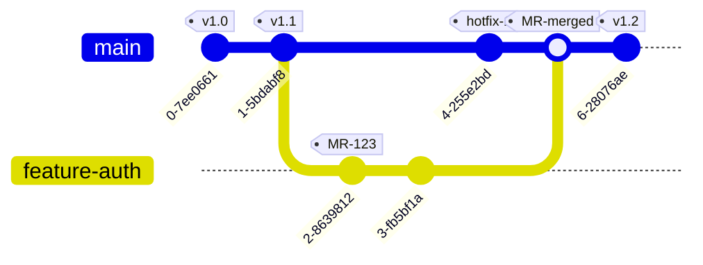
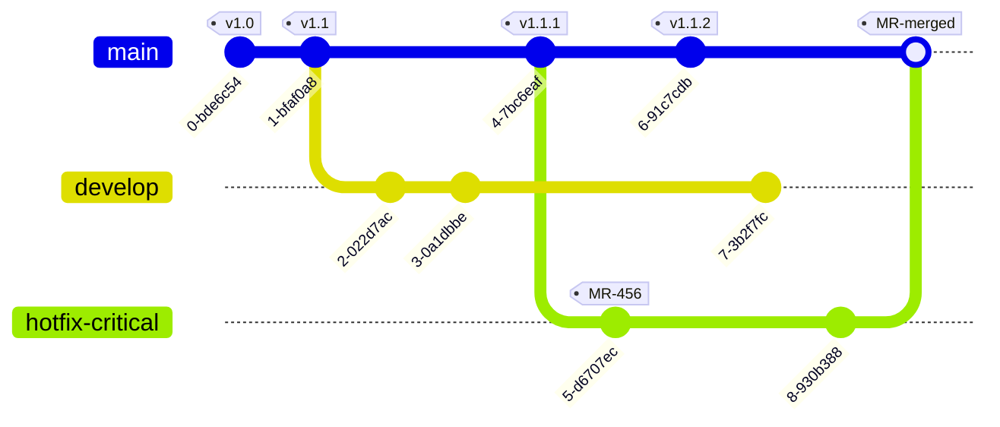
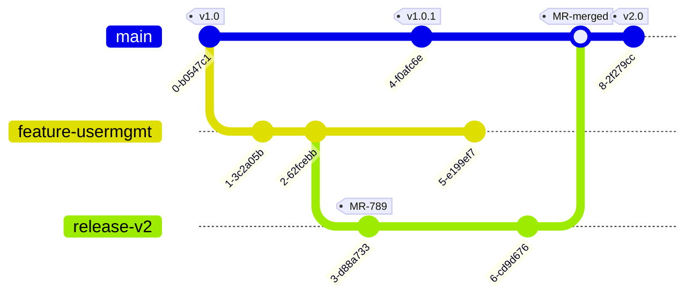
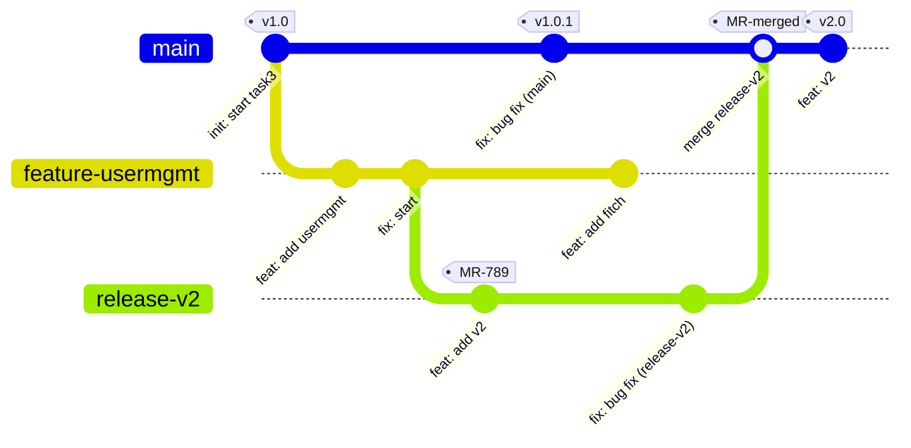
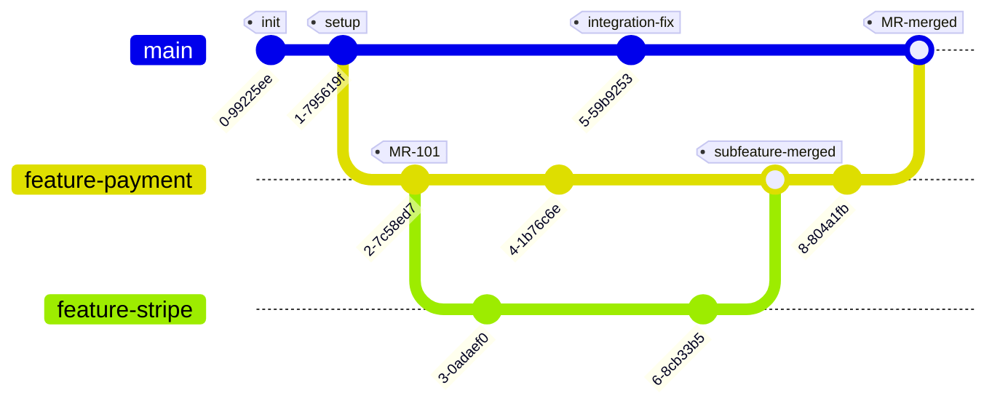
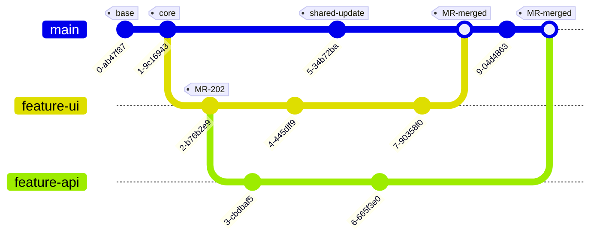

### Самостоятельное задание 1

**Описание:** Feature branch с merge request

Создайте feature branch, добавьте в него несколько коммитов, затем объедините ветку через merge request (симулируя создание MR/PR в реальных системах контроля версий).




**Ход выполнения**

В первом задании нужно отделить работу над авторизацией от основной ветки. Начальные два коммита в `main` отмечаются тегами `v1.0` и `v1.1`. От второго создаётся `feature-auth`, где сохраняются ещё два изменения. Тег `MR-123` ставится на первый коммит этой ветки.

Затем работа продолжается в `main`: там появляется отдельное исправление `hotfix-1`. После этого `feature-auth` объединяется с `main`. Получается коммит слияния, который связывает обе истории. Последнее изменение делается уже после объединения и отмечается тегом `v1.2`.

**Команды для выполнения:**
```Shell
git add .  
git commit -m ""  
git tag "v1.0"  
git add .  
git commit -m ""  
git tag "v1.1"  
git checkout -b "feature-auth"  
git add .  
git commit -m ""  
git tag "MR-123"  
git add .  
git commit -m ""  
git checkout "main"  
git add .  
git commit -m ""  
git tag "hotfix-1"  
git merge "feature-auth"  
git commit -m ""  
git tag "MR-merge"  
git add .  
git commit -m ""  
git tag "v1.2"
```

**Полученный граф:**
![[2026-10-13_11-36-26.png]]


### Самостоятельное задание 2

**Описание:** Hotfix с merge request

Создайте hotfix ветку для срочного исправления, затем объедините ветку через merge request.

**Целевой граф репозитория:**


**Ход выполнения**

Сначала я сделал в `main` два коммита и поставил теги `v1.0` и `v1.1`. От второго коммита создал `develop` и сохранил в ней два изменения. Эта ветка нужна для отдельной работы, которая пока не должна попасть в основную версию.

Вернувшись в `main`, я сделал исправление `v1.1.1`. От него создал `hotfix-critical`, записал первое срочное исправление и поставил тег `MR-456`. После этого в `main` появился ещё один коммит — `v1.1.2`. Работа в остальных ветках тоже продолжилась: я добавил по коммиту в `develop` и `hotfix-critical`.

В конце объединил `hotfix-critical` с `main` и отметил слияние тегом `MR-merged`. Ветка `develop` осталась отдельно: её изменения в это слияние не вошли.


**Команды для выполнения:**

```Shell
git add .
git commit -m "init: start task2"
git tag "v1.0"
git add .
git commit -m "fix: fix"
git tag "v1.1"
git checkout -b "develop"
git add .
git commit -m "feat: add dev.md"
git add .
git commit -m "feat: add new"
git checkout "main"
git add .
git commit -m "fix: bug fix"
git tag "v1.1.1"
git checkout -b "hotfix-critical"
git add .
git commit -m "fix: hotfix"
git tag "MR-456"
git checkout "main"
git add .
git commit -m "fix: bug fix"
git tag "v1.1.2"
git checkout "develop"
git add .
git commit -m "feat: new new"
git checkout "hotfix-critical"
git add .
git commit -m "fix: new fix"
git checkout "main"
git merge "hotfix-critical" 
git tag "MR-merged"
```

**Полученный граф:**
![[2026-10-14_12-59-26.png|617]]


### Самостоятельное задание 3

**Описание:** Release branch с merge request

Создайте release branch, добавьте в него несколько коммитов, затем объедините ветку через merge request.

**Целевой граф репозитория:**


**Ход выполнения**

От начального коммита `v1.0` я создал ветку `feature-usermgmt` и сделал в ней два коммита. Затем от второго ответвил `release-v2`. В ней сохранил изменение для релиза и поставил тег `MR-789`.

Дальше изменения шли в трёх ветках. В `main` я сделал исправление `v1.0.1`, в `feature-usermgmt` добавил следующий коммит, а в `release-v2` — своё исправление. Последний коммит `feature-usermgmt` не попал в релизную ветку, потому что она была создана раньше.

После этого я переключился на `main` и влил в неё `release-v2`. Параметр `--no-ff` задаёт создание отдельного коммита слияния; его я отметил тегом `MR-merged`. Ещё один коммит в `main` после объединения получил тег `v2.0`.


**Команды для выполнения:**
```Shell
git add .
git commit -m "init: start task3"
git tag "v1.0"
git checkout -b "feature-usermgmt"
git add .
git commit -m "feat: add usermgmt"
git add .
git commit -m "fix: start"
git checkout -b "release-v2"
git commit -m "feat: add v2"
git tag "MR-789"
git checkout "main"
git add .
git commit -m "fix: bug fix"
git tag "v1.0.1"
git checkout "feature-usermgmt"
git add .
git commit -m "feat: add fitch"
git checkout "release-v2"
git add .
git commit -m "fix: bug fix"
git checkout "main"
git add .
git merge release-v2 --no-ff -m "merge release-v2"
git tag "MR-merged"
git add .
git commit -m "feat: v2"
git tag "v2.0"
```


**Полученный граф:**




![[Pasted image 20261014170029.png]]
 PyCharm почему то рисует граф так(


### Самостоятельное задание 4

**Описание:** Complex feature с merge request

Создайте сложную структуру feature веток с несколькими подветками, затем объедините все через merge request.

**Целевой граф репозитория:**

**Ход выполнения**

Здесь я сначала подготовил два коммита в `main` с тегами `init` и `setup`. От `setup` создал ветку `feature-payment`, добавил в неё первый коммит и отметил его тегом `MR-101`. Уже от этой точки создал подветку `feature-stripe` и сделал в ней отдельный коммит.

Затем я по очереди сохранил изменения в `feature-payment`, `main` и `feature-stripe`. Исправление основной ветки отметил тегом `integration-fix`. На этом этапе у каждой ветки были свои новые коммиты.

Объединение проходило в два этапа. Сначала я влил `feature-stripe` в `feature-payment` и поставил тег `subfeature-merged`. После дополнительного исправления в платежной ветке объединил её с `main`. Поэтому в основную ветку вошли и изменения платежей, и ранее добавленные изменения Stripe. Последнее слияние получило тег `MR-merged`.


**Команды для выполнения:**
```Shell
git add .
git commit -m "init: start task4"
git tag "init"
git add .
git commit -m "feat: setup"
git tag "setup"
git checkout -b "feature-payment"
git add .
git commit -m "feat: payment"
git tag "MR-101"
git checkout -b "feature-stripe"
git add .
git commit -m "feat: stripe"
git checkout "feature-payment"
git add .
git commit -m "fix: fix"
git checkout "main"
git add .
git commit -m "fix: fix"
git tag "integration-fix"
git checkout "feature-stripe"
git add .
git commit -m "fix: fix"
git checkout "feature-payment"
git merge feature-stripe --no-ff -m "merge: stripe-payment"
git tag "subfeature-merged"
git add .
git commit -m "fix: fix merged"
git checkout "main"
git merge feature-payment --no-ff -m "merge: main-payment"
git tag "MR-merged"
```


**Полученный граф:**
![[Pasted image 20261014171943.png]]


### Самостоятельное задание 5

**Описание:** Multiple features с merge request

Создайте несколько параллельных feature веток, затем объедините все через merge request.

**Целевой граф репозитория:**


**Ход выполнения**

Я сделал в `main` начальные коммиты `base` и `core`, затем создал `feature-ui`. Её первый коммит отметил тегом `MR-202`. Ветку `feature-api` создал от этого коммита, поэтому она уже содержала начальную часть истории UI.

После первого коммита API вернулся в `main`, сохранил обновление и поставил тег `shared-update`. Потом добавил по исправлению в `feature-api` и `feature-ui`. Эти изменения оставались в своих ветках до слияния.

Первой я объединил с `main` ветку `feature-ui` и поставил тег `MR-merged`. Затем сделал отдельное исправление в основной ветке и только после него влил `feature-api`. Для второго слияния использовал тег `MR-merged-api`, поскольку имя `MR-merged` уже было занято.


**Команды для выполнения:**
```Shell
git add .
git commit -m "init: start task5"
git tag "base"
git add .
git commit -m "feat: core"
git tag "core"
git checkout -b "feature-ui"
git add .
git commit -m "feat: ui"
git tag "MR-202"
git checkout -b "feature-api"
git add .
git commit -m "feat: api"
git checkout "feature-ui"
git add .
git commit -m "fix: super fix"
git checkout "main"
git add .
git commit -m "feat: update"
git tag "shared-update"
git checkout "feature-api"
git add .
git commit -m "fix: fix api"
git checkout "feature-ui"
git add .
git commit -m "fix: fix ui"
git checkout "main"
git merge feature-ui --no-ff -m "merge: main-ui"
git tag "MR-merged"
git add .
git commit -m "fix: fix fix"
git merge feature-api --no-ff -m "merge: main-api"
git tag "MR-merged-api"
```


**Полученный граф:**
![[Pasted image 20261014173251.png]]
Случайно пропустил комит в feature-ui(


## Трудности при выполнении заданий

В третьем задании меня сначала запутал граф в PyCharm. Ветка `release-v2` выглядела как продолжение общей линии, а `feature-usermgmt` — как короткое ответвление. Оказалось, что нужно смотреть на связи между коммитами, а не только на цвет и расположение веток. Изменение сортировки переставило коммиты на экране, но не изменило саму историю.

В пятом задании не получилось второй раз создать тег `MR-merged`: такое имя уже существовало. Для слияния API я использовал другое — `MR-merged-api`.


## Вывод по работе

В этой работе я потренировался создавать ветки, переключаться между ними, сохранять изменения и объединять их. 
Я разобрался, что перед слиянием нужно перейти в ту ветку, которая должна принять изменения.